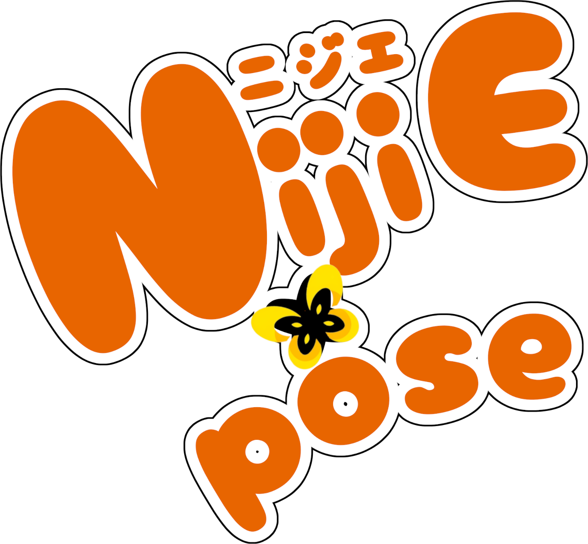

# 

model by [seagetch](https://twitter.com/seagetch)

*nijiexpose is the official tool for using nijilive puppets for VTubing.*

This application is currently under heavy development and isn't ready for production just yet.
The current implementation uses C++ and nicxlive. See the
[remaining migration tasks](NATIVE_CPP_TASKS.md) for feature differences from the D version.

## Downloads

Download release packages from [Releases](https://github.com/nijigenerate/nijiexpose/releases).
Native version-tag releases provide the following packages:

- **Windows x64**: run the `.msi` installer to install the application and shortcuts.
- **macOS arm64**: open the `.dmg` and copy the application to Applications.
  The app is ad-hoc signed; Developer ID signing and notarization are not configured.
- **Linux x86_64**: make the `.AppImage` executable and run it on Ubuntu 24.04
  or a compatible system. A compatible graphics driver and desktop dialog support
  are required; see the [package guide](build-aux/README.md).

Packages include the tracker task models, translations and dependency notices.
Nightly ZIP packages are available for portable use; keep the extracted directory
structure intact.

Windows builds run without a console window. Diagnostic output, including Lua
`print` and dependency output, is saved to
`%LOCALAPPDATA%\nijiexpose\logs\nijiexpose.log`. At startup, logs of 5 MiB or
larger are moved to `nijiexpose.log.previous`. If the log directory is unavailable,
output is discarded so logging does not prevent startup.

### Experimental Builds

Nightly builds provide ZIP packages for Windows, macOS and Linux, but we do not
guarantee stability. These versions may crash unexpectedly, and you are likely to
encounter bugs. Be sure to save and back up your work frequently!

Build artifacts are also available from the
[native CI workflow](https://github.com/nijigenerate/nijiexpose/actions/workflows/native-cpp.yml).

## Tracker settings

nijitrack is embedded in the application and runs in worker threads. Configure
the camera in tracking settings. Tracking results are delivered directly to the
application.

The required face and hand `.task` models are bundled with the packages. No
separate tracker download, Python environment or tracker executable is required.

## Building

The quick start guide [BUILD.md](BUILD.md) contains instructions for building,
testing and packaging nijiexpose on Windows, macOS and Linux.
The `native-vulkan` branch also provides a [Vulkan model and ImGui renderer](BUILD.md#vulkan-renderer-native-vulkan), based on nijimi.
Use the `native-opengl-release` and `native-vulkan-release` CMake presets for separate builds with renderer-specific dependencies.

Translations use GNU gettext; see [translation maintenance](tl/README.md).
The previous D implementation and its build assets are retained in
[dlang_archive](dlang_archive/README.md).
